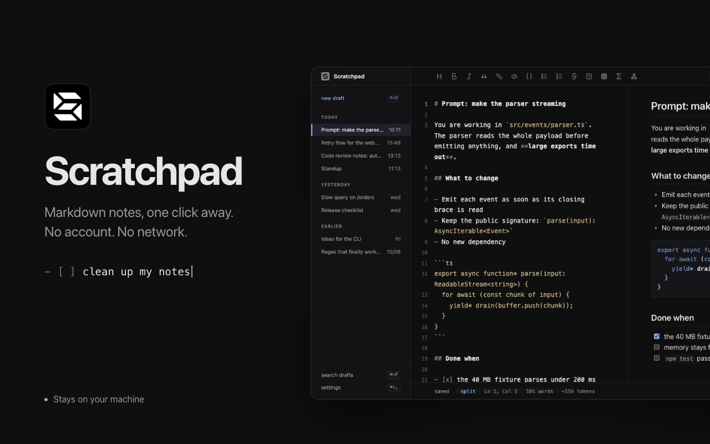

# Scratchpad

A markdown scratchpad one click away on the Chrome toolbar. No account, no
network: your drafts never leave your machine.

**[Install from the Chrome Web Store][store]**

[][store]
[](https://github.com/m4rcone/scratchpad/actions/workflows/ci.yml)
[](LICENSE)
[](https://ko-fi.com/m4rcone)



Version **1.5.0**.

## Principles

1. Nothing waits on the disk.
2. Saving is automatic and silent.
3. No network requests. No telemetry. No permission beyond what is needed.
4. Markdown is the editing format.

## Features

- **Always at hand.** Opens from the toolbar or `⌥⇧S`, reusing its tab, on the
  draft you left with the caret in place. Every keystroke is saved.
- **Write, split, read.** Source with visible, dimmed markers; a live preview
  beside it; or the rendered page alone, at a reading measure, optionally in a
  serif.
- **Focus.** The text alone, in any view, at a width you set by dragging.
- **Rich preview.** GitHub-flavoured markdown, code highlighting, LaTeX,
  mermaid and `:emoji:`, with embedded HTML sanitized. Task boxes tick from
  the preview. Front matter is coloured as YAML and left out of the preview.
- **Drafts.** Titled by their first line, or their front matter's `title:`
  or `name:`, with full-text search, find and replace, and undo after delete.
  Two open tabs stay in sync.
- **Status bar.** Save state, view, line and column, words and a rough token
  count. Optional line numbers in the margin.
- **Import and export.** Copy or export a draft as `.md`, drop a `.md` or
  `.txt` file to open it, back everything up to one `.json` and restore it
  with a preview of the changes, or export all drafts as a `.zip`.
- **Themes.** Light and dark, following the system or set by hand.

## Shortcuts

On Windows and Linux, `⌘` is `Ctrl` and `⌥` is `Alt`.

| shortcut | action                                                     |
| -------- | ---------------------------------------------------------- |
| `⌥⇧S`    | open Scratchpad from anywhere in Chrome ¹                  |
| `⌘⇧D`    | new draft                                                  |
| `⌘⇧F`    | search drafts                                              |
| `⌘F`     | find and replace (`⌘G` / `⌘⇧G` next, previous)             |
| `⌘/`     | split view                                                 |
| `⌘⇧P`    | reading view                                               |
| `⌘⇧↵`    | focus                                                      |
| `⌘⇧A`    | copy the draft                                             |
| `⌘S`     | export as `.md`                                            |
| `⌘⇧,`    | settings                                                   |
| `esc`    | back to writing, leave focus, close a panel, undo a delete |

¹ Configurable at `chrome://extensions/shortcuts`. The `?` button on the
toolbar lists every shortcut, formatting included.

## Install

Install it from the [Chrome Web Store][store] (Chrome 120+), then pin it from
the puzzle-piece menu to keep its icon on the toolbar.

### From source

Requires Node 22.18+.

```bash
git clone https://github.com/m4rcone/scratchpad.git
cd scratchpad
npm install
npm run build
```

In `chrome://extensions`, enable developer mode, choose **Load unpacked** and
select `dist/`. Pin the extension to keep its icon on the toolbar.

## Development

| command                           | action                               |
| --------------------------------- | ------------------------------------ |
| `npm run dev`                     | Vite dev server                      |
| `npm run build`                   | type-check and build `dist/`         |
| `npm test`                        | unit tests                           |
| `npm run lint` / `npm run format` | ESLint / Prettier                    |
| `npm run package`                 | zip `dist/` for the Chrome Web Store |
| `npm run icons`                   | regenerate the icons                 |

The dev server has no content security policy; test anything network-related
against `dist/`.

## Privacy

Drafts live in your Chrome profile and are erased when the extension is
uninstalled, so back them up from **settings** first. The only permission is
`storage`, for preferences; there is no host permission and no access to the
pages you visit. See [PRIVACY.md](PRIVACY.md).

## Support

Scratchpad is free. If it saves you time, you can support it on
[Ko-fi](https://ko-fi.com/m4rcone).

## License

[MIT](LICENSE) © Marcone Boff

[store]: https://chromewebstore.google.com/detail/scratchpad/pfcimbknnlnnebpaohbocihjjmcejoml
